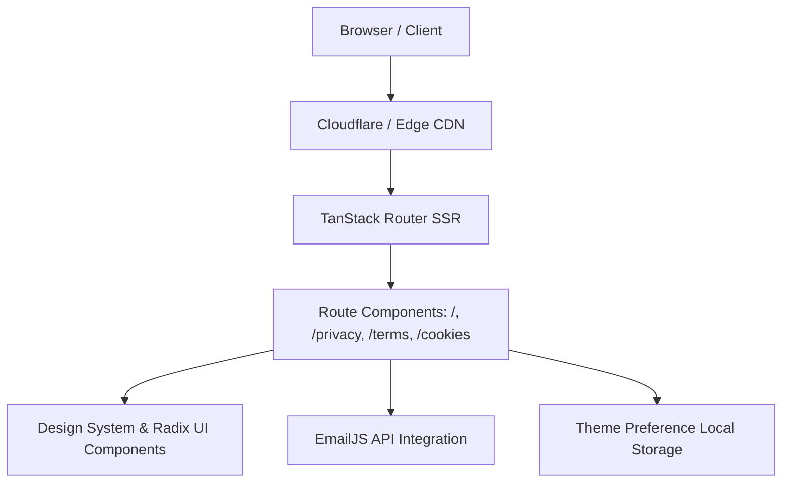

# System Architecture

## Architecture Diagram

## Architectural Highlights
- **Isomorphic Rendering**: Server-side rendering paired with client-side hydration via TanStack Start.
- **Type-Safe Routing**: File-based routing with automatic route tree code generation (`src/routeTree.gen.ts`).
- **Decoupled Messaging**: Contact inquiries directly authenticated and sent via EmailJS browser SDK, avoiding unnecessary backend server attack surfaces.
